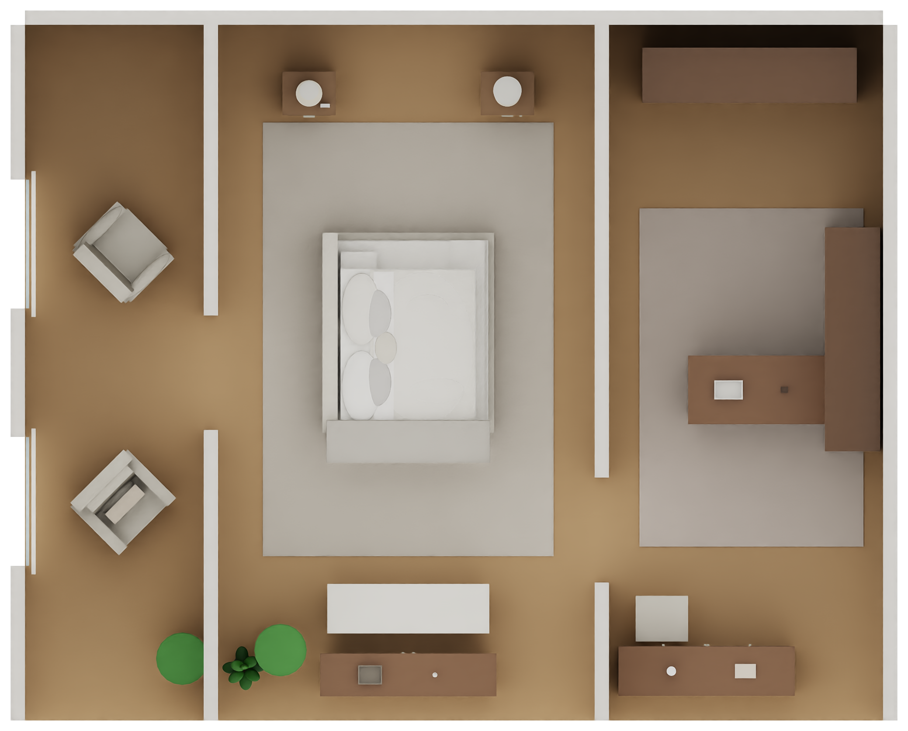
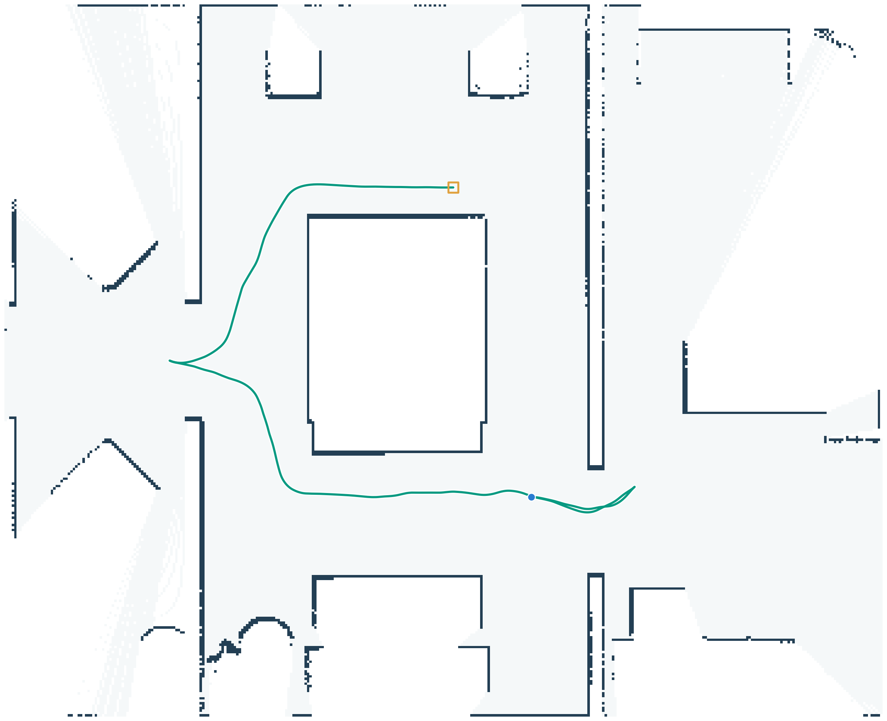
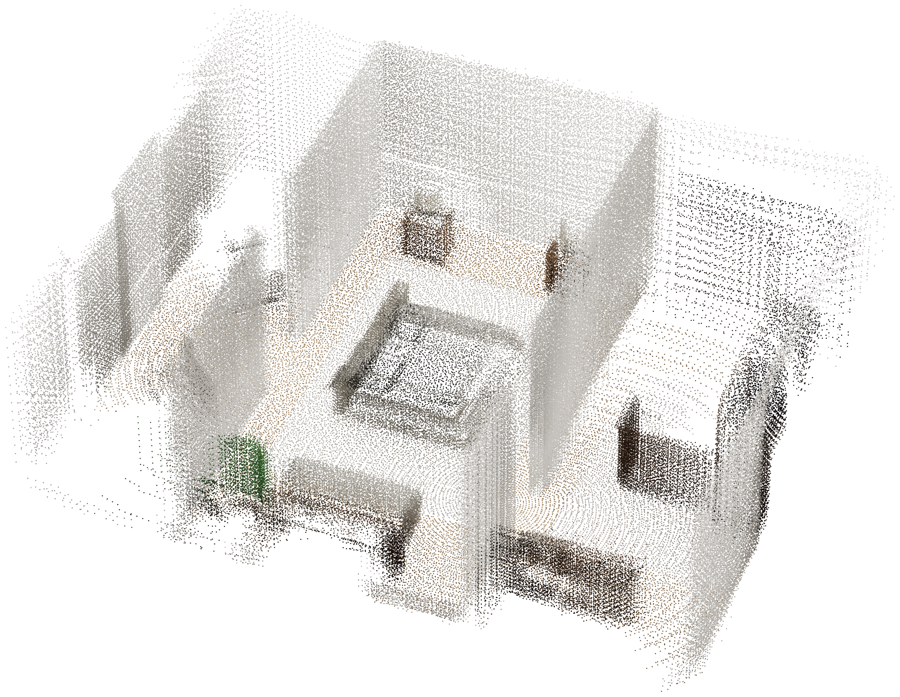

# 陌生室内场景中的建图导航与展示工作总结

这次工作在已有轮足训练与 MuJoCo sim2sim 工程之上，增加了 Isaac Sim 的虚拟雷达、扫描建图、在线探索与 Nav2 接口，并将场景修改、点云和图片导出脚本整理到仓库。已有训练任务、策略和 MuJoCo runner 未作修改。当前成果验证到高层导航和简化运动执行；缺少最新 RL checkpoint，未验证双轮足平衡或实物自主导航。

代码入口见 [research/README.zh.md](../research/README.zh.md)。本目录保存少量代表性结果；原始扫描、运行日志、软件环境和外部家具资产留在本地，不加入 Git。

## 哪些改动实际影响了结果

| 改动 | 原因与作用 | 主要代码 |
| --- | --- | --- |
| 从预设巡视转为在线探索 | 从空白地图寻找已知与未知边界，按预计新增观测、路程和访问记录选目标，扫描更新后重新决策 | `scan_nav/exploration.py`、`scripts/ros_frontier_explorer.py` |
| 接入真实 SLAM Toolbox 与 Nav2 | 将扫描、误差里程计、TF 和仿真时钟接入独立 ROS 进程，接收实际 `/cmd_vel` | `run_online_exploration.py`、`ros2_sensor_bridge.py`、`launch/slam_nav.launch.py` |
| 用完整矩形表示机器人 | 原直径 0.76 米圆在约 0.62 米的间隙中阻断通行；改为模型约 0.50×0.53 米的完整包络，加 1 厘米余量，并检查朝向 | `scan_nav/footprint.py` |
| 改用考虑朝向的路径搜索 | Nav2 Smac Hybrid A*、目标位姿检查和实际路径预检查；比较 DWB 与 RPP，保留失败状态 | `slam_nav.launch.py`、`ros_frontier_explorer.py` |
| 改善观测位置与失败处理 | 远目标拆为当前已知地图中的短距离观察点，减少近期失败目标的重复尝试 | `ros_frontier_explorer.py` |
| 允许新回波修正代价地图边缘 | SLAM 栅格多占几厘米时可能封住窄通道；只用实际扫描更新障碍，禁止仅凭身体所在位置擦除障碍 | `slam_nav.launch.py` |
| 修正机器人外观 | 从 `wheeled_arm_v2` URDF 与训练配置生成弯腿、收臂姿态，未缩放模型 | `prepare_wheeled_arm_visual.py` |
| 加宽床头与床尾通道 | 房间两端各扩展 0.65 米，家具与装饰同步移动，保留内部隔墙和门洞；床头约 1.2075 米，床尾约 1.2700 米 | `prepare_code_room_open_passages.py` |
| 移除休息区入口小桌 | 将小桌与两组桌上物品从独立 USD 层停用，外观与 14 个碰撞体一并退出场景 | 同上 `--remove-lounge-table` |
| 按实际地板范围评价 | 新房间从 54 平方米变成 65.7 平方米；覆盖率分母随场景变化，离线评价检查实际朝向下的完整包络 | `analyze_autonomy.py` |
| 导出三维点云 | 用真实三维雷达深度和 SLAM 平面位姿拼接，原生射线标定与平面扫描交叉检查 | `capture_lidar_ray_calibration.py`、`export_slam_reconstruction.py` |
| 用原场景 RGB 配色 | 用深度遮挡检查将原生相机渲染颜色配准到扫描点；取消高度伪彩色默认值 | `colorize_lidar_from_isaac_rgb.py` |
| 输出干净的展示资产 | 点云和单张轨迹去掉坐标、标题与对比数字；场景采用正交俯视和透明背景 | `export_clean_visuals.py`、`render_modified_room_white.py` |

表内 Python 工具位于 `research/`，导航代码位于 `modules/wheeled_navigation/`，仿真与桥接代码位于 `modules/wheeled_sim_bridge/`。

## 实际保存的实验结果

以下结果来自各轮保存的评价文件，精简记录见 [navigation_results/metrics.json](navigation_results/metrics.json)。它们是历史实验，并非本次打包后重新运行的完整仿真。

| 实验 | 场景面积 m² | 已观测投影 m² | 占房间面积 | 结束情况 |
| --- | ---: | ---: | ---: | --- |
| 原圆形轮廓 `autonomy_ros_code_room_v2` | 54.0 | 22.1725 | 41.06% | 时间预算结束，中间通道反复行驶 |
| 矩形轮廓 `autonomy_ros_polygon_v5` | 54.0 | 22.7300 | 42.09% | 进入右侧区域后返回 |
| 矩形后续配置 `autonomy_ros_polygon_v12` | 54.0 | 19.0600 | 35.30% | 返回，覆盖未超过 v5 |
| 加宽通道 DWB `autonomy_ros_open_passages_v1` | 65.7 | 39.8300 | 60.62% | 进入床左侧，返航失败 |
| 加宽通道 RPP `autonomy_ros_open_passages_v2` | 65.7 | 42.0000 | 63.93% | 绕床后返回 |
| 移除小桌 RPP `autonomy_ros_no_table_v1` | 65.7 | 43.2575 | 65.84% | 靠近休息区入口，返航失败 |
| 移除小桌 DWB `autonomy_ros_no_table_v2` | 65.7 | 44.1475 | 67.20% | 底座中心进入左侧门洞西面，返航失败 |

覆盖统计的是房间范围内、同一张 5 厘米评价栅格上的已观测 XY 投影，包括障碍格。它不是可通行地面覆盖率，也不是三维表面重建率。各轮运行时长、时序与控制器不同，不能把所有差异归因于单项改动。`complete` 只表示该轮结束后返回成功，不表示全屋覆盖。

移除小桌的 DWB 轮在约 60.2 秒时底座中心越过左隔墙西侧面，最左 x 约 -2.807 米；完整身体尚未全部越过该平面，不能写成已经完成穿门和深入左侧休息区。所有已做完整矩形检查的表内实验均未发现与场景障碍 AABB 重叠，但此检查不等于刚体接触与平衡验证。

## 地图与点云分别是什么

导航使用 SLAM Toolbox 的二维占据栅格。`measured_baseline/` 是事后按仿真坐标对齐的评价图，ROS 探索器不会收到它，也不读取源场景布局。

三维点云的 XYZ 由记录的真实雷达回波与 SLAM 估计的 x/y/yaw 拼接，采用固定高度和零横滚、俯仰假设，尚未运行完整六自由度三维 SLAM。代表性点云由 194 帧扫描获得，经 3.5 厘米体素去重后保留 248,330 个点。

颜色来自建图结束后按记录传感器位置补渲染的 RGB 图像，不是当时同步采集的相机流。配色注册会使用记录的仿真位姿对齐相机像素和原始射线，点云 XYZ 保持 SLAM 拼接结果。248,033 个点直接取得 RGB，129 个点采用 6.5 厘米内的已配色邻点，168 个点保留中性灰。

原生射线标定与用于导航的已保存平面扫描抽查误差约 0.123 毫米，与深度量化步长一致。PLY 和 HTML 保留所有扫描点；静态点云预览仅去掉近侧外墙的高处点，便于看清室内。

## 代表性结果

修改后的独立场景：

本次新场景中覆盖较好一轮的真实地图与执行轨迹：

同一轮雷达点云的原色展示：

[原色点云 PLY](navigation_results/slam_pose_cloud_rgb.ply)可用本地点云软件查看。图片为透明 PNG，没有标题、刻度和对比数字；白色墙面与点之间的空隙保持原色与透明。

## 本次没有验证的内容

- 没有接入最新 RL checkpoint；速度积分不能代表双轮足动力学、平衡或轮地接触成功。
- 没有证明完整六自由度三维 SLAM、回环实际发生或完整三维重建。
- 没有完成全屋覆盖；局部跟随、窄通道朝向与返航仍有失败。
- 没有实物雷达、相机或 Jetson 部署实验，也没有声称模型权重下载能替代这些验证。

后续应先修正探索与返航的可靠性，再接入实际训练策略与真实传感器。早期预设路线演示代码保留作对照，明确标为采集或可视化基线，不作为自主探索证据。

## 本次整理后的验证

- 导航核心与探索行为测试 12 项全部通过，脚本编译与启动器 CLI 检查通过。
- 从仓库现有 URDF 与训练配置重新生成 13 个连杆的弯腿、收臂可视资产，源文件未修改。
- 从仓库根目录执行原生验证场景的 12 秒短时检查：真实 PhysX 三维雷达有回波，机器人实际移动约 2.57 米，完成 12 次在线重规划并保存扫描与状态。该检查按时间限制结束，状态仍为未完成，不冒充全流程探索验收。
- 本次未重新运行完整 ROS 覆盖率实验，前表来自保留的历史结果。
