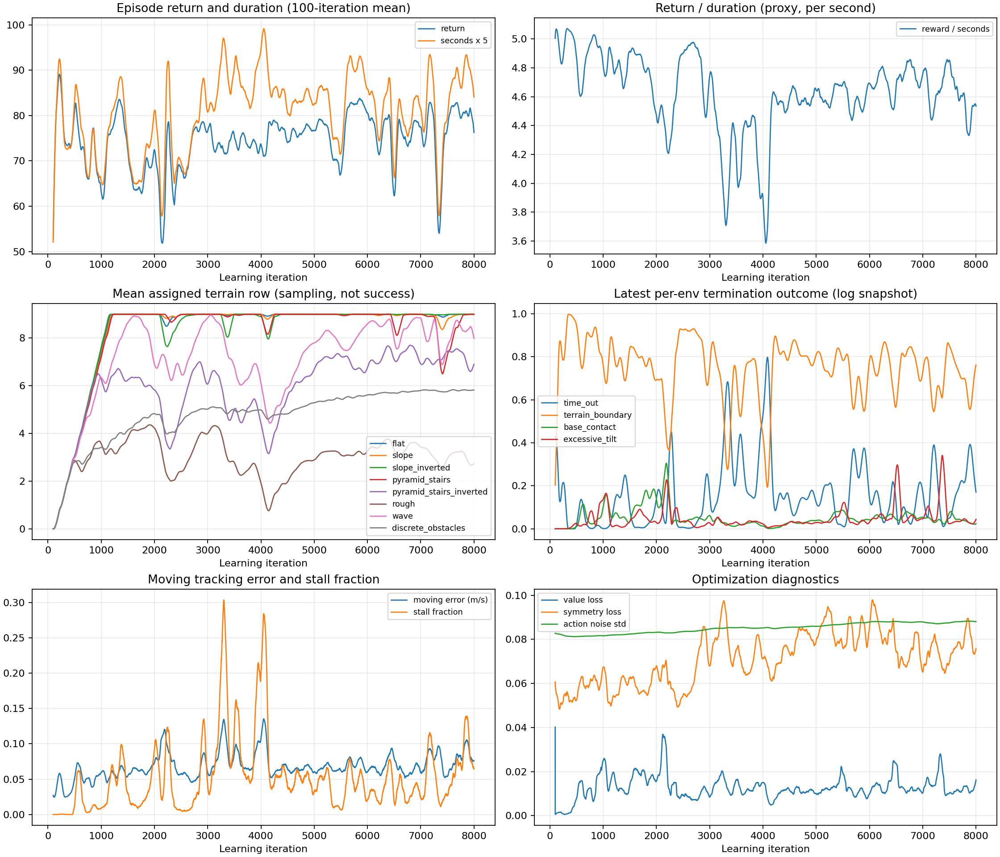

# Terrains Focus 阶段复盘与下一步训练

## 判断

这次 8000 轮 focus 训练成功完成，但**尚未满足进入 retention、高速训练或实机验证的条件**。总奖励峰值不能代表困难地形已经掌握。当前最明确的缺口是高难度粗糙地形：本次所测模型在第 7、9 行各 48 个首回合中都没有一次通过粗糙地形；focus 训练结束时粗糙地形的平均分配行也只有 2.75。离散障碍和下台阶在第 9 行同样明显退化。

下一轮建议从历史 `scratch6000` checkpoint 开始做**低学习率的 focus 延续试验**。它是在相同固定评估中已测候选里，第 7、9 行下台阶、粗糙、离散障碍三类的等权通过率最高者（36.88%），也比 focus 最后模型的 19.58% 高。此选择是当前有限筛查中最合适的起点，不代表它已达到通行要求或是所有历史 checkpoint 中全局最优。若优先避免归一化统计继续在线漂移，也可将当前 run 的 `focus6000` 作为第二候选做同初始种子的短 A/B。

## 训练变化

本轮实验为 `2026-10-21_11-14-05_low_speed_focus`，从 `2026-10-19_19-59-28/model_7000.pt` warm start，保留了 100,001,552 条观测归一化统计；使用 seed 42、terrain seed 43，2048 环境、每环境每轮 32 步，共 524,288,000 个采样步。不是从零训练，也不是之前建议的 scratch6000 起点。

| 训练窗口 | 平均回报 | 平均回合时长 | 平均地形行 | 移动跟踪误差 | 停滞比例 |
|---|---:|---:|---:|---:|---:|
| 0–199 | 70.41 | 14.30 s | 0.31 | 0.0407 m/s | 0.01% |
| 800–999 | 66.70 | 13.63 s | 5.18 | 0.0562 m/s | 1.01% |
| 1800–1999 | 70.59 | 15.40 s | 6.24 | 0.0675 m/s | 6.24% |
| 3800–3999 | 73.86 | 18.44 s | 5.53 | 0.0985 m/s | 17.50% |
| 5800–5999 | 81.93 | 17.78 s | 6.34 | 0.0684 m/s | 3.79% |
| 7800–7999 | 78.13 | 17.50 s | 6.28 | 0.0864 m/s | 9.15% |

200 轮移动平均奖励峰值为 83.14，结束于第 5858 轮；此后奖励没有稳定保持在峰值。奖励与时长共同变化：第 3800–3999 轮时回合变长、奖励也较高，但跟踪误差和停滞比例显著恶化。因此这段增长不能单独解释为运动能力改善。最终噪声标准差约 0.088，价值损失没有发散；曲线表现更像课程难度与回合结局变化造成的高方差，不足以诊断为 PPO 数值不收敛。



`Train/mean_reward` 是最近 100 个结束回合的累计回报均值。`Episode_Reward/*` 是各项回合积分除以 20 秒上限，提前结束的 episode 会同时压低多项正奖励。终止项的 TensorBoard 值只是每个环境当前保留的最近终止标记均值，不是对应窗口的 episode 失败率。课程计数是累计计数，窗口差值只能近似估计课程尝试/成功率。

奖励管理器每控制步把每项乘以 `dt=0.008`。所以 `termination_penalty=-50` 的摔倒终止单步贡献约为 -0.4，而非 -50；`commanded_stall=-0.5` 每步至多贡献 -0.004。命令速度为 0.25 m/s 且机器人静止时，速度跟踪项仍约为 `3*exp(-1)=1.104` 每秒奖励，存活另加 1 每秒，单看这两项已高于最大停滞惩罚。这说明停滞时仍可能保持正回报，是值得做的奖励消融方向，但仅凭曲线不能断言它是唯一原因。

## 固定条件 checkpoint 评估

下表每个 checkpoint 在第 4、7、9 行各运行 192 个首回合；reset seed 42、地图 seed 43、目标速度 0.25 m/s。关闭动作和观测噪声、冻结观测归一化，保留环境物理随机化。通过同时要求正向位移、持续时间、命令位移比例、跟踪误差、姿态和无物理终止。重点类型宏平均对高行 7/9 和三类（下台阶、粗糙、离散障碍）等权，避免被平地样本量左右。

| checkpoint | 第 4 行全类型通过率 | 第 7/9 行重点类型宏平均 | 第 7/9 行物理失败率 |
|---|---:|---:|---:|
| 历史 scratch6000 | 82.29% | **36.88%** | 38.28% |
| 初始化 source7000 | 89.58% | 28.61% | 46.88% |
| focus2000 | 76.04% | 18.75% | 32.81% |
| focus4000 | 23.44% | 10.42% | 14.32% |
| focus6000 | 83.85% | 27.92% | 30.21% |
| focus7999 | 72.92% | 19.58% | 42.97% |

| checkpoint | 行 | 下台阶通过 | 粗糙通过 | 离散障碍通过 | 全类型物理失败 |
|---|---:|---:|---:|---:|---:|
| scratch6000 | 7 | 39/40 | 3/48 | 28/40 | 25.00% |
| scratch6000 | 9 | 10/40 | 0/48 | 9/40 | 51.56% |
| focus6000 | 7 | 22/40 | 0/48 | 31/40 | 27.08% |
| focus6000 | 9 | 0/40 | 0/48 | 14/40 | 33.33% |
| focus7999 | 7 | 12/40 | 0/48 | 21/40 | 33.85% |
| focus7999 | 9 | 0/40 | 0/48 | 14/40 | 52.08% |

Focus 训练和本次评估使用同一个地图生成 seed 43，因此结果是可复现的固定地图筛查，**不是 held-out 地图泛化验证**。每个子类型样本较少，置信度有限；候选仅包含上一轮筛过的历史模型和本轮 2000/4000/6000/7999，不能声称搜索了全部 161 个 checkpoint。训练课程阈值与评估阈值也不相同：训练配置为 0.15 m/s，本评估成功判定更严，为 0.10 m/s。

## 后续流程

1. 先从历史 scratch6000 进行 1000 轮 focus 延续，初始学习率降为 `3e-5`，每 250 轮保留 checkpoint。保持地形生成、命令速度、奖励、轮腿限幅和环境随机化不变，只调低学习率，方便判断延续是否稳定。先不要增速，也不要立即改停滞/上升/腿部对称奖励。
2. 比较同一初始 checkpoint、seed 42 的短 A/B：主组仅降低学习率；若主组仍出现训练回报上扬但固定困难地形通过率不升，再从同一 checkpoint、同 seed 单独测试 `commanded_stall` 权重 `-1.0`。每组各训练 500–1000 轮，不能同时改学习率和奖励权重。
3. 每 250 轮从 checkpoint 做固定行评估；先测行 4/7/9 和三类重点地形，候选阶段可以每行 192 个首回合。固定种子筛选之后，最终候选再扩大到每行 768 环境，并用 reset seeds 42/43/44 与 terrain seeds 43/44/45 复核。
4. 只有在 held-out 复测达到：行 4 各类型通过率至少 95%，行 7/9 每类重点地形通过率至少 80%，物理失败率不高于 10%，才进入 retention（恢复较均衡地形采样）。retention 仍维持 0.25 m/s。条件未通过，就继续 focus 或单项消融。
5. 完成 retention 后，再另立速度阶段，从 0.25 m/s 小步提高并验证；当前策略没有高速能力证据，轮速目标限幅对应的理想滚动速度约 0.56 m/s，不能把本轮结果外推到此前约 1.8 m/s 的目标。一个网络可以条件化学习不同命令，但应先证实该机器人与执行器在该速度下可行；现在没有理由拆成两个策略网络。

## 可直接执行的命令

```bash
cd /home/moujank/project/wheeled-leg-ws/modules/wheeled_train/wheeled_leg
TERRAIN_PY=/home/moujank/miniconda3/envs/env_isaaclab/bin/python
TERRAIN_INIT=/home/moujank/project/wheeled-leg-ws/modules/wheeled_train/wheeled_leg/logs/rsl_rl/wheeled_leg_terrains/2026-10-20_09-29-55/model_6000.pt

"$TERRAIN_PY" scripts/rsl_rl/train.py \
  --task Wheeled-Leg-Terrains --headless --num_envs 2048 \
  --max_iterations 1000 --seed 42 --terrain_phase focus \
  --run_name focus_scratch6000_lr3e5 \
  --init_checkpoint "$TERRAIN_INIT" \
  agent.algorithm.learning_rate=0.00003 \
  env.scene.terrain.visual_material=null \
  env.scene.sky_light.spawn.texture_file=null
```

`--init_checkpoint` 会新建训练 run 并加载策略与归一化状态；它不恢复上轮优化器，也不恢复上轮课程 streak。若短 A/B 确认停滞惩罚不足，第二组从同一路径重新开始，仅额外加：

```bash
  env.rewards.commanded_stall.weight=-1.0
```

不要把这项与第一组一起启用，以保留可解释的对照。评估新 checkpoint 时：

```bash
"$TERRAIN_PY" scripts/rsl_rl/probe_terrain_transfer.py \
  --headless --checkpoint /绝对路径/model_250.pt \
  --scene terrain --level 7 --speed 0.25 --num_envs 192 \
  --seed 42 --terrain-seed 44 --preserve-count \
  --output /绝对路径/eval_row7_map44.json
```

用 held-out `--terrain-seed 44`（以及 45）检查地图变化；在完成固定 probe 前，不应只看可视化单次表现选模。当前报告工作没有改动生产任务配置，也没有启动新的训练。

## 可复核产物

- [训练曲线 PNG](focus_training_review.png)
- [训练曲线 PDF](focus_training_review.pdf)
- [固定评估表](evaluation_results.zh.md)
- [逐 checkpoint 固定评估图](fixed_evaluation.png)
- [完整窗口指标 JSON](curve_metrics.json)
- [可重复的曲线分析脚本](analyze_focus.py)
- [可重复的评估汇总脚本](summarize_evaluations.py)
