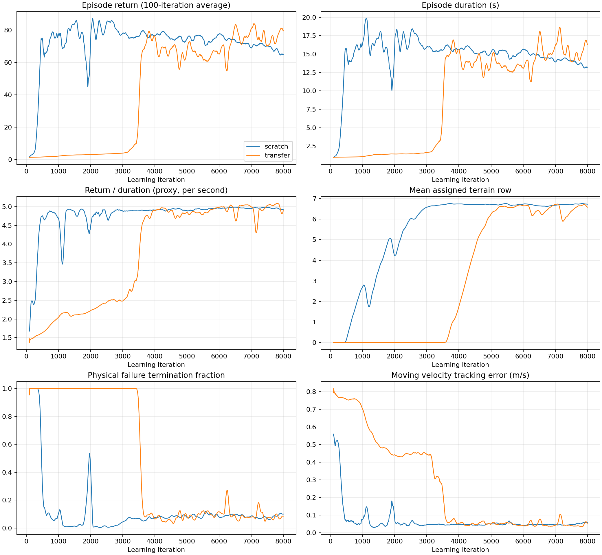

# Terrains 训练曲线、迁移验证与低速越障计划（2026-10-20）

## 结论与实验对应

本报告按本地 TensorBoard 日志复核两条曲线：从零训练为 `2026-10-20_09-29-55`，迁移训练为 `2026-10-19_19-59-28`。两次保存的 env/agent YAML 内容一致、训练 seed 均为 42，但初始化状态不同。这是一组单种子历史对比，不能用来证明从零训练普遍优于正确实施的迁移。

当前证据支持继续使用同一个速度命令条件策略，先专注 0.25 m/s 的前向越障。没有证据表明必须拆分低速、高速两个网络。原始约 2 m/s 目标超出现有轮速目标限幅对应的理想滚动速度，增加网络数不能解决这一执行能力限制。后续若确实需要高速，应另立执行器和高速运动验证项目，避免与困难地形课程同时升级。

迁移训练的长平台与归一化历史被重置导致的能力损失有关；已在不执行任何 PPO 更新的真实 GPU 仿真中复现。当前 terrains 已保留成熟归一化统计计数。本次工作没有写入 v1 环境配置；但执行期间检测到了外部改动，详见下文，不能声称整个检查期间该文件未发生变化。

## 两条曲线的量化比较

| 指标 | 从零训练 | 历史迁移训练 |
|---|---:|---:|
| 20 轮滑动平均回报首次达到 70 | 第 407 轮 | 第 3620 轮 |
| 末 200 轮平均累计回报 | 64.84 | 79.71 |
| 末 200 轮平均回合时长 | 13.17 s | 16.19 s |
| 平均回报 / 平均时长（辅助指标） | 4.923 /s | 4.924 /s |
| 末 200 轮平均分配地形行 | 6.742 | 6.653 |
| 接触或过度倾斜终止比例 | 10.27% | 7.61% |
| 地形边界终止比例 | 84.14% | 82.54% |
| 有效移动速度跟踪误差 | 0.0583 m/s | 0.0491 m/s |
| 初始动作噪声标准差 | 0.3502 | 0.0820 |
| 5000 轮之后回报与回合时长相关系数 | 0.990 | 0.936 |



从零训练早期学得更快，但不能据此说其末期更好；迁移训练早期严重失稳，约 3500 轮后才恢复。这不是一个保留了源策略能力的正常迁移基线。

`Train/mean_reward` 是 RSL-RL 最近 100 个已结束回合累计回报的均值，不是固定长度的测试成绩。Isaac Lab 的 `Episode_Reward/*` 则将各项回合积分除以固定回合上限 20 秒。因此回合提前结束时，多个正奖励项会一起下降，不能单独解释成某个控制项退化。比如末尾存活项从零为 0.6588，迁移为 0.8088，分别接近 13.17/20、16.19/20。

正奖励占比较高时，回报约等于单位时间奖励乘以回合长度。更早到达正向边界可能代表快速通过，却减少累计存活奖励；摔倒也会缩短回合，但含义完全不同。边界超时还可能从错误方向越界，必须加方向、位移、姿态和跟踪条件。当前曲线中既有课程引起的非固定分布，又有真实的接触/倾斜失败。高相关性只支持回合长度解释，不能证明每次下跌都无害。

例如末 200 轮，线速度奖励 1.868 对 2.279、角速度奖励 0.636 对 0.780、存活奖励 0.659 对 0.809 都受长度影响。不能把这些值直接当作瞬时跟踪准确率。`curve_metrics.json` 保存各奖励项完整末段均值。

| 末200轮 Episode_Reward 均值（积分/20秒） | 从零训练 | 历史迁移训练 |
|---|---:|---:|
| 线速度跟踪 | 1.8676 | 2.2792 |
| 角速度跟踪 | 0.6364 | 0.7801 |
| 存活 | 0.6588 | 0.8088 |
| 前向进展 | 0.3825 | 0.4389 |
| 有支撑的上升 | 0.00558 | 0.00455 |
| 命令下停滞 | -0.00075 | -0.01611 |
| 腿关节偏离 | -0.2299 | -0.2394 |
| 姿态 | -0.02095 | -0.02114 |

两组正回报主要仍来自跟踪与存活，有支撑上升项的平均贡献很小，无法把总回报当成主动抬腿越障的直接评分。迁移组的停滞负项也更大，值得在失败轨迹中检查受阻停留；这些积分统计无法单独证明奖励权重就是失败原因。下一步先集中采样并记录实际失败动作，若困难地形仍不改善，再用单项消融判断抬轮激励、姿态约束或执行器饱和的影响。

课程平均等级表示当前环境分配，不表示每一种地形都已掌握。末段粗糙地形平均行仅为 3.605 / 3.824，明显落后于全局均值。损失变小也不保证困难地形成功率已收敛。应以固定行、固定速度、固定种子的通行测试作为选模标准。

## 迁移是否保留了源能力

### 真实 GPU 短实验

共同条件：seed=42、64 个环境、0.25 m/s、每个环境只计首个完整回合，最多 20 秒，无 PPO 权重更新；关闭观测噪声，保留训练环境的接触参数/质量/初始状态随机化。平坦网格对照使用同一 terrains 场景和前向命令。归一化对照安装实际训练使用的对称归一化。

| 策略与条件 | 摔倒数 / 64 | 首回合平均时长 | 平均速度误差 |
|---|---:|---:|---:|
| 10-17 v1/7999，原平地环境、原动作限幅 | 0 | 20.00 s | 0.0187 m/s |
| 10-17 v1/7999，terrains 平坦网格、原动作限幅、冻结统计 | 0 | 15.12 s | 0.0185 m/s |
| 10-19 v1/7999，原平地环境、原动作限幅 | 0 | 20.00 s | 0.0158 m/s |
| 10-17 terrains/7999，平坦网格、原窄限幅、冻结统计 | 0 | 14.16 s | 0.0406 m/s |
| 同一个 terrains/7999，原窄限幅、计数重置 10000 后在线更新统计 | 64 | 1.39 s | 0.4405 m/s |
| 同一个 terrains/7999，新宽限幅、保留原计数并进入训练模式 | 2 | 19.31 s | 0.0982 m/s |
| 历史迁移 run 的 model_0，新宽限幅、冻结其保存的统计 | 64 | 2.46 s | 0.4357 m/s |

原 v1 平地对照运行时仅固定命令并按 checkpoint 维数选择观测，未写入 v1 配置文件。平地没有地形边界终止，因此 20 秒 time_out 与 terrains 中约 15 秒的正向通过不可直接比时长。旧 v1 在平坦网格中 64/64 满足通行条件。

文件变更边界：v1 原生对照输出保存于 19:17–19:18；随后在 19:23:16 检测到 v1 源文件由其他操作修改，当前包含显式 `velocity_limit_sim=2π` 执行器设置。本次没有恢复或覆盖该文件。检查前 SHA256 为 `6a5fbd72356eb400513455a0ed1b18a177added8e976de0b1a70999ddf4f300e`，19:23 后为 `8a72e644127825a0e4998bf88ae22b35665d869a726948583ff4ea2a7964c75a`。上述 v1 原生结果适用于修改前的运行条件；修改后的 v1 若要作为后续基线，需要重新验证。Terrains 固定难度选模没有采用 v1 场景，保持相同的 terrains 执行器设置。

所有已测模型加载瞬间的原始动作最大差为 0（新增高度输入列初始为 0 权重，已有输入按语义映射）；这只能确认加载行为，不能保证随后在线归一化更新仍保留能力。对照恰好显示了这一点。

旧源策略归一化 count 为 100001552，已超过 RSL-RL 默认 `until=100000000`。此前 warm start 将 count 压到 10000，重新启用了快速统计更新。新采样和频繁失败重置改变输入分布，从而在网络权重完全不变时破坏控制器。修正只对 terrains 启用“保留原 count”，其他调用者默认行为保持原样。低 count 模型保留 count 后仍可能继续更新，并不意味着一律冻结所有模型。

宽限幅对源策略的影响也可见，但样本不足以精确估计小概率失效率。为困难地形保留宽限幅是为了主动腿部动作；当前推荐选择已在宽限幅中训练过的近期 terrains checkpoint，避免再从窄限幅源模型跨一次动作分布。

### 历史源模型归属需要纠正

对 `2026-10-19_19-59-28/model_0.pt` 与历史文件的匹配架构 actor 参数比较，排除会被归一化重参数化的首层 weight 后，最近的非自身模型是 `2026-10-17_17-43-03/model_7999.pt`，RMS 差约 0.00011995。它属于旧 terrains，而非最新 v1。`model_0` 已经历首轮更新，不能要求逐位相同。这是强权重相似性证据，不等同于保存的启动命令证明；源路径原先没有被写入实验元数据。

现在 `train.py` 会在新的 warm start 日志目录写入 `initialization.json`，记录源 checkpoint 绝对路径、SHA256、归一化 count 及训练阶段，便于复核。

继承的小动作噪声（约 0.082，而从零为 0.35）会减少新动作探索，也是可能影响恢复速度的因素；本次没有完成单独噪声消融，不能分配其影响大小。先修正已复现的归一化问题，不同时盲目改变网络、噪声、学习率和所有奖励权重。

## v1 与 terrains 的迁移相关差异

| 项目 | v1 | 当前 terrains | 迁移影响 |
|---|---|---|---|
| actor / critic 观测数 | 当前 34 / 41；历史 28 / 35 | 82 / 89 | 当前 v1 新增 6 维 joint_effort，不能直接按旧 54 维追加规则迁移 |
| 新增外部感知 | 无 | 54 个高度样本 | 旧 28/35 输入可按语义映射，新增列从 0 权重开始 |
| 机器人、默认姿态、执行器 | 相同资产与默认姿态；执行期间外部加入显式速度限制 | 显式 velocity_limit_sim=2π | 当前字段一致；修改前 v1 原生对照不能用于证明全部执行器行为等价 |
| 物理步长、动作频率 | .002 s、decimation=4 | 相同，125 Hz | 无需另改 v1 |
| 腿动作倍率 | .25 | .25 | 相同倍率不代表相同最终目标 |
| 左 Hip / Knee 最终目标裁剪 | (.3,1.0) / (.9,1.7) | (.15,1.25) / (.4,2.2) | 同一原始动作可能产生不同腿目标；右腿镜像 |
| 轮动作 | scale=4、最终 ±6 rad/s | 相同 | 约 .0935 m 半径下理想滚速约 .56 m/s；还需扭矩与稳定裕量 |
| 命令 | 正反向/偏航重采样，含站立 | 整回合世界 +X 目标，航向反馈 | 可行技能和状态访问分布变化 |
| 地形和终止 | 平地，无地形边界 | 8 类地形、边界结束 | 回合累计回报不可直接横比 |
| 奖励 | 基础速度跟踪/姿态/动作约束 | 增加进展、支撑上升、停滞，越障时放宽部分腿/姿态约束 | 旧 critic 价值目标也变化 |

最新 34/41 输入 v1 需要显式处理 effort 观测，当前 terrains 迁移器会因尺寸不兼容拒绝该直接加载。不能靠前缀裁剪丢掉 effort。旧 27/10 输入、不同隐藏结构的最早 v1 也不适合直接加载。现阶段无必要增加这种适配，因为已经有 82/89 的 terrains 策略可用。

## 当前环境的调整

- 统一前向目标 0.25 m/s，无站立、无速度课程，最大加速度 .20 m/s²。任务限定前向通行，不代表任意方向导航能力。
- 所有环境均可提升地形行，取消原每 5 个环境保留 1 个在容易地形的速度训练分组。
- 升级仍要求实际前进至少 2.6 m、达到积分命令距离 65%、持续时间至少 8 s、无物理失败且姿态合格、横向偏移受限；连续两次成功升级。训练跟踪阈值放至 .15 m/s，允许短暂爬升减速；本次固定评估使用更严格的 .10 m/s。
- 保留现有机器人、动作接口、82/89 输入、障碍几何和越障奖励，不通过降低最大障碍高度提高分数。
- `foundation`、`focus`、`retention` 只改变 24 个地形列的分配，每个新阶段从第 0 行开始重新证明能力。默认 focus。

| 阶段（每行共 24 列） | 平地 | 坡 | 反坡 | 上台阶 | 下台阶 | 粗糙 | 波浪 | 离散障碍 |
|---|---:|---:|---:|---:|---:|---:|---:|---:|
| foundation | 3 | 3 | 3 | 3 | 3 | 3 | 3 | 3 |
| focus | 2 | 1 | 1 | 3 | 5 | 6 | 1 | 5 |
| retention | 3 | 2 | 2 | 3 | 4 | 4 | 2 | 4 |

focus 将 2/3 环境分给下台阶、粗糙和离散障碍。已有课程会根据每类表现自动保持在可学习行；无需把所有环境直接放到第 9 行反复摔倒。

## 固定条件选模

选模结果与具体 checkpoint 见 [固定难度选模表](selection_results.zh.md)；训练与评估命令见项目根目录 [TERRAINS_TRAINING.zh.md](../../TERRAINS_TRAINING.zh.md)。本报告末尾也记录最终选择与短程训练验证。

测试四个候选：从零 6000 / 7999 轮，迁移 7000 / 7999 轮。每个候选分别在第 4、7、9 行测试 192 个环境，共 2304 个首回合。所有候选使用同一 geometry seed=43、reset seed=42、.25 m/s、宽腿限幅、冻结归一化；保持训练环境的初始状态/质量/摩擦随机化，关闭观测腐蚀。每个环境只计第一次结束，防止快速摔倒者重复贡献更多样本。

每行分母固定：flat16、slope8、slope_inverted8、stairs24、inverted_stairs40、rough48、wave8、discrete40。排名采用第 7/9 行三个重点困难类型通行率的等权平均，不由平地数量或训练奖励主导；同时公开低难度和摔倒率。通过条件是持续前向位移和稳定跟踪，不能保证路径经过随机地图中的每个障碍。一次地图种子只够筛查初始模型，不是最大难度可靠性的最终证明。

## 后续训练与迁移到实际系统

1. 从本次固定评估筛选的 terrains 权重开展 focus 微调，建议先 2000 轮、4096 环境、seed42；每 500 轮固定评估，若困难类型退化则回退到已测较好模型，不按最后一轮自动选模。新分布用 `--init_checkpoint`，不用 `--resume`。网络与观测归一化一起保存、一起部署。
2. 用 focus 最佳评估 checkpoint 启动 retention 1000–2000 轮，增加容易地形比例，确认平地、坡和波浪能力没有丢失。没有必要先丢弃已经学到的 terrains 技能再回平地训练。只有已选模型在低行验证失败时，才考虑 foundation；从零起步也先用 foundation。
3. 训练完至少用 reset seed42/43/44，独立 geometry seed43/44/45，固定行0/4/7/9 做评估。固定行后禁用课程；重点类型至少累计100首回合/种子/行，并报告置信区间。建议验收目标：容易行各类型≥95%，困难行重点类型≥80%、物理失败≤10%。这些是待验证门槛，当前模型尚未达成。
4. 实际迁移先核对关节顺序/符号、弧度单位、位置偏置、轮速限幅、125 Hz 控制频率、观测尺度和归一化状态；高度扫描需相同坐标系、顺序、采样间距和缺测处理。若真实系统无法提供这54维感知，不可直接把扫描置零后宣称同一策略已迁移成功，应另做感知适配或教师学生训练。
5. 先在另一仿真器复核相同命令下的平地及障碍响应，再按实测质量、惯量、关节摩擦、轮地摩擦、延迟、噪声和电机能力设置随机化。真实试验从受保护的低速平地开始，随后逐级障碍，关注实际通过率、轮打滑、接触、姿态和电流/扭矩；保留已验证 checkpoint 便于回退。
6. 在上述低速能力达标前不增加高速目标。若后续硬件与高速动作验证支持，可尝试同一命令条件策略的小范围速度扩展并保留低速样本；只有明确出现稳定且无法缓解的多任务干扰，才有必要评估双策略及切换过程。

## 历史 checkpoint 盘点与证据文件

`checkpoint_inventory.csv` 列出本地 24 个 v1/terrains 实验、1512 个 checkpoint 的实际绝对路径、轮次、actor/critic 输入数。它是本次扫描时的文件清单，不包括之后新产生的 smoke 或正式训练文件。

- 10-13 早期 v1（27/10）不兼容当前架构；10-13 下午和10-17稳定基线 v1（28/35）可作为历史平地对照。
- 10-19 v1（34/41）原生平地稳定，但需新的 effort 观测适配才能进当前 terrains。
- 10-17 早期只训练0–450轮的失败迁移/验证 run 用于诊断，不作越障起点。
- 10-17 14:34 terrains 末段回报约49.61、地形均值.382，未有效覆盖困难地形。
- 10-17 17:43 terrains 末段回报约92.02、地形均值4.384；是历史迁移初始权重的最近匹配来源，旧动作/命令分布与当前不同。
- 10-18 15:40 terrains 末段回报约78.05、地形均值6.985，只有训练统计，本次未做同协议完整筛选，不能据此排在已评估模型前面。
- 10-19迁移与10-20从零两个完整实验，各161个checkpoint，是本次主要候选池。这里只筛选其中4个代表性checkpoint，不声称找到1512个文件中的全局最优。

`historical_runs.json` 保存每个run末段指标及100轮滑动奖励峰值；峰值用于定位回溯点，不作为直接选模依据。`source_matches.json`、`historical_environment_diff.json`、每个probe的JSON/log以及 `curve_metrics.json` 保存推断所需证据。旧版训练说明已存为 `previous_training_notes.zh.md`，其中旧checkpoint推荐由本次固定评估替代。

## 本次最终选模与验证记录

12组固定行评估全部完成，共2304个首回合。四个候选在容易类型上表现接近，但困难类型存在显著差异：

| 候选 | 第4行整体通过率 | 第7/9行重点类型平均通过率 | 第7/9行平均物理失败率 |
|---|---:|---:|---:|---:|
| scratch6000 | 82.29% | 36.88% | 38.28% |
| scratch7999 | 86.46% | 32.50% | 45.31% |
| transfer7000 | 89.58% | 28.61% | 46.88% |
| transfer7999 | 90.62% | 26.18% | 45.57% |

本次采用第7/9行重点类型平均通过率优先，并结合物理失败率选择微调起点：

```text
/home/moujank/project/wheeled-leg-ws/modules/wheeled_train/wheeled_leg/logs/rsl_rl/wheeled_leg_terrains/2026-10-20_09-29-55/model_6000.pt
```

第6000轮从零模型在第7行：下台阶39/40、粗糙3/48、离散28/40；第9行分别10/40、0/48、9/40。它只是相对更适合下一阶段困难地形训练，并非已可靠解决越障。四个候选在第9行粗糙地形均为0/48。

迁移末轮在第4行的整体通过率90.63%，高于从零第6000轮的82.29%，所以如果产品只要求中等难度，选模目标可能不同。本次任务重点是提高困难地形通行，优先选择后者。完整各类型分母和原始文件见 selection_results.zh.md / selection_summary.json。

已完成真实 GPU PPO 短程验证：64环境、2次更新、4096 transitions，实验目录 `/home/moujank/project/wheeled-leg-ws/modules/wheeled_train/wheeled_leg/logs/rsl_rl/wheeled_leg_terrains/2026-10-20_19-50-52_low_speed_traversal_smoke`。actor/critic输入82/89、固定学习率1e-4、focus采样均正确；网络权重实际更新且数值有限，归一化count在加载前后与更新后均为100003840。初始化记录的源路径与SHA256已核验，详见 `ppo_smoke_verification.json` 和 `ppo_smoke.log`。短程尚无完整回合，日志中的回合指标为0不代表性能退化；此验证只证明训练链路可运行，不证明通行能力提高。

首次短程启动暴露了新元数据记录早于日志目录创建的问题，已修复创建顺序后重新运行通过。完整回归测试70项通过（4条已有ONNX/GRU相关警告），修改后的脚本也通过编译检查。正式focus/retention训练尚未运行，后续应按固定评估选择模型，不使用本次仅2次更新的smoke模型作为正式推荐起点。
